# Getting started

This page is for a first session with QSEQ. It covers what's on the screen, the three places notes go, and
a first song from an empty start. The [user guide](user-guide.md) has every page and control.

It assumes the full build is on the FM-1 ([README, Installing on the device](../README.md#installing-on-the-device)),
or that you're in the browser preview, which has the same song mode.

## Before the first song

**Check the version.** The boot screen shows QSEQ with its version under it, and a small grid that fills in
the track colors as the FM-1 starts. The bottom line names the FM1 Open release it's built on.

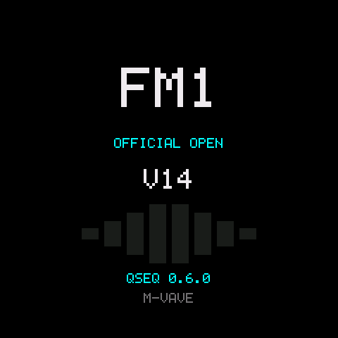

**Send the sounds, once.** The full build leaves the factory sounds out to make room for the song mode. Open
the workbench ([README, The workbench](../README.md#the-workbench)) with the FM-1 connected and click **Send
the built-in kit** and **Send the factory DX7 voices**. Until the voices are sent the DX7 presets are blank, and
the built-in kit gives the drum pads FM1 Open's 8 built-in sounds. The voices stay on the device through
firmware updates.

**SHIFT means holding FX.** Every SHIFT+ in these docs is FX held down while you press the other control. A
quick tap of FX opens the effects page instead.

**A tap and a hold do different things** on a few buttons. A hold is 600 ms.

| Button | Tap | Hold | With SHIFT |
|---|---|---|---|
| REC | Record | The record settings | Step entry |
| GLO | The song settings | The mixer, which stays open when GLO is let go | The device settings |
| ARP | The arpeggiator on or off | Its settings | |
| FX | The effects page | SHIFT | |

## The screen

The song view is where most work happens. SEQ opens it from the stock pages.

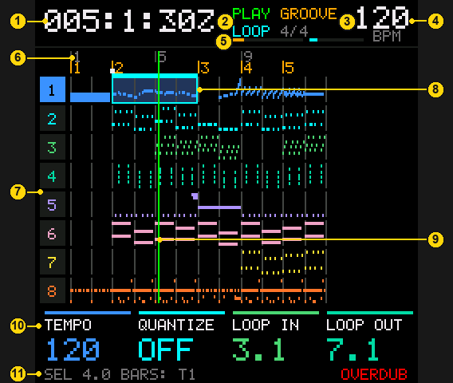

1. Where the playhead is: bar, beat and clock. There are 480 clocks to a quarter note.
2. PLAY, STOP or REC. Under it, LOOP lights while the loop is on.
3. The marker section the playhead is in, GROOVE here, and the time signature. With a clip open it says CLIP
   and the clip's row.
4. The tempo at the playhead.
5. Memory. The first bar is flash, songs in green and kits in amber. The second is the song's own event
   memory.
6. The ruler: bar numbers in grey and markers in amber. The small white mark is the start point, where PLAY
   starts and where a stop comes back to.
7. Tracks 1 to 8. SELECT picks the current track, which is lit.
8. The loop region, shaded across the tracks. The cyan box marks it on the selected tracks. That box is the
   selection, which copy, paste, delete and the edit jobs work on.
9. The playhead.
10. The knob labels. K1 to K4 are the four knobs above the screen, left to right, with their values under
    the labels. They change from page to page, so this is the first place to look on a new page.
11. The bottom line: the selection (here 4 bars on track 1), then hints and notices as you work. REC's mode
    is in red at the right.

The header and the knob labels work the same way on every song page.

## Where notes go

There are three places, and they all feed one song.

| Place | What it is | How to get there |
|---|---|---|
| Song view | The song from start to end, on all 8 tracks. What's recorded here plays back in order | SEQ from the stock pages |
| Clip grid | Loops. Each cell holds a clip, one track's loop from a beat to 16 bars long, launched from the keys | SEQ in the song view |
| Step entry | One track's notes as a piano roll, entered key by key at a pointer | SHIFT+REC in the song view, or on a row of the grid |

### The clip grid

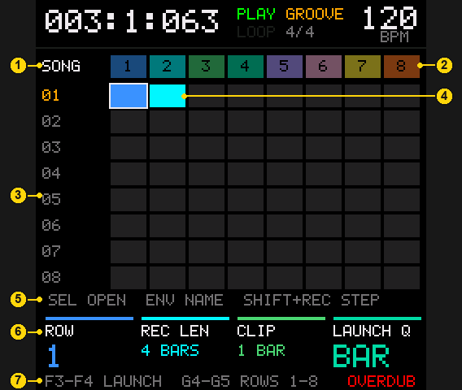

1. The SONG row. A tap of REC here records a performance into the song (step 5 below).
2. The tracks, one column each.
3. The rows. There are 16, in two pages of 8. K1 moves the cursor through them.
4. Clips, in their track's color. The white outline is the cursor.
5. Hints: SEL opens the clip at the cursor, ENV names the row, SHIFT+REC is step entry.
6. K1 is the row, K2 the length of a new recording, K3 the clip's length, K4 the launch quantize.
7. F3 to F4 launch the cursor row's cell on tracks 1 to 8. G4 to G5 launch rows 1 to 8 on every track at once.

### Step entry

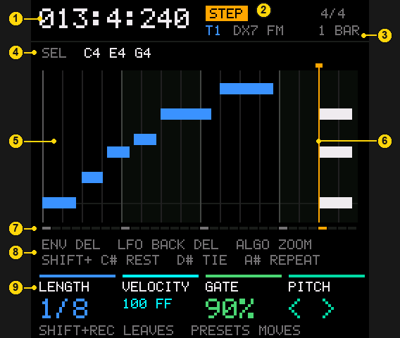

1. The pointer's position, where the next note goes.
2. STEP, then the track and its sound.
3. The time signature, and how wide the roll is zoomed (ALGO).
4. The notes at the pointer. The knobs and delete work on these.
5. The roll, with notes at their real lengths.
6. The pointer, in amber. The notes at it are white.
7. One dash per step, with the pointer's lit.
8. Hints for the delete buttons and the SHIFT keys.
9. LENGTH, VELOCITY and GATE set the next note, or change the notes at the pointer. PITCH moves those notes.

## A first song

This builds a short song from the grid, then finishes it in the song view.

**1. Pick the sounds.** HOME goes to the stock overview. SELECT picks a track, and PRESETS steps through its
presets. To change the instrument, turn ALGO or K2 there to open SELECT SOUND SOURCE, turn to DX7 FM, BASS 303,
DRUM 808, PSG, PLUCK or SAMPLER, and press SAVE to switch (HOME cancels). Holding HOME and turning PRESETS
opens the same page from anywhere. A new instrument starts from its own defaults. The song saves its tracks'
sounds with it.

**2. Record a loop.** SEQ goes to the song view, and SEQ again to the grid. SELECT picks the track, and K1
puts the cursor on row 01. K2 is the length to record, 4 bars to begin with. Tap REC: a bar of count-in,
then play. The screen shows the take as a roll. After 4 bars the recording stops and the clip plays on,
looping.

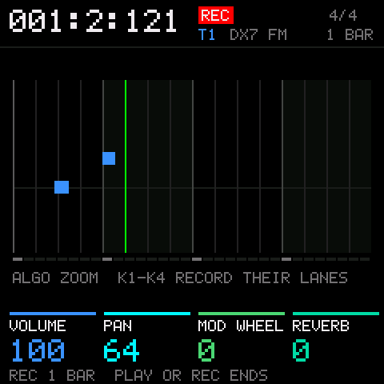 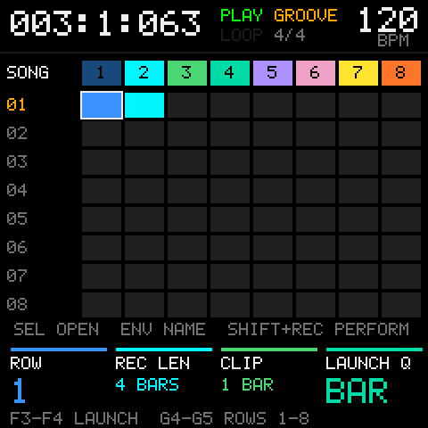

**3. Add parts.** SELECT another track and tap REC again on the same row. While the first clip plays, the new
one starts recording at the next bar, the launch quantize, with no count-in. F3 to F4 launch a single cell,
and G4 to G5 a whole row. PLAY stops everything.

**4. Fix notes.** Stop first with PLAY. With the cursor on a clip, SHIFT+REC opens it in step entry. PRESETS
moves the pointer, and landing on notes selects them. ENV deletes them, K1 to K3 change them and K4 moves
their pitch. A key enters a note at the pointer. PLAY plays the clip without leaving. SHIFT+REC goes back to
the grid.

**5. Put the loops in the song.** There are two ways.

- *Perform it.* Move the cursor to the SONG row with K1 and tap REC to arm. Then PLAY, and launch rows with G4
  to G5 the way the song should go. REC ends it. Every launch becomes a block in the song.
- *Place it.* On a clip, SHIFT+F3 copies it. SEQ goes to the song view, PRESETS moves the playhead to a bar,
  and SHIFT+A3 pastes the clip there as a block.

A block plays its clip, so editing the clip in the grid changes every block of it.

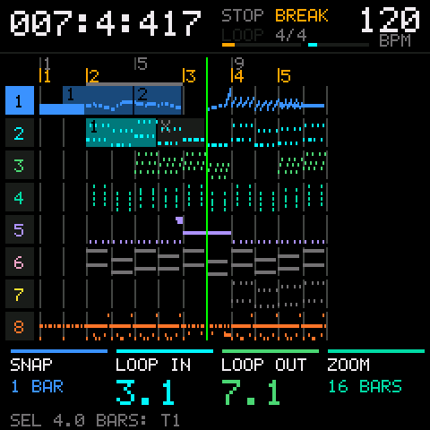

**6. Record into the song.** In the song view, stopped, PRESETS moves the playhead. Tap REC for a count-in and
a take on the current track. The song starts in OVERDUB, so new notes add to what's there. REC or PLAY ends the
take and playing goes on. With the loop off (ENV), playing past the last bar keeps recording, and the song
grows to fit. Turning K2, the input quantize, right after a take requantizes it.

**7. Arrange.** The loop region is the selection. K3 and K4 set its bars. Hold SEL and tap F3 to F4 to pick
tracks, or G4 for all of them. Then:

| Keys | Action |
|---|---|
| SHIFT+F3 | Copy |
| SHIFT+A3 | Paste at the playhead |
| SHIFT+C4 | Duplicate right after the selection |
| SHIFT+E4 | Delete what's selected |
| SHIFT+D4 | Insert empty bars |

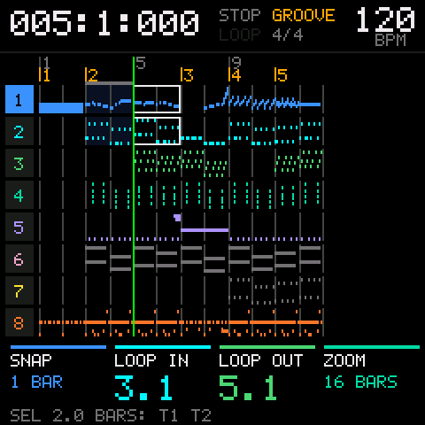

**8. Undo and save.** HOME+SAVE undoes and SHIFT+HOME+SAVE redoes. SAVE opens the song list, and SAVE there
saves, so a save is SAVE, SAVE. To name the song, turn K2 to RENAME and press OCT+ (YES). K1 picks a letter,
K2 changes it, and YES keeps the name.

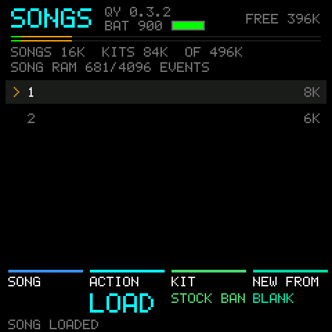

## Recording automation

1. In the song view, stopped, pick the track with SELECT and tap REC.
2. After the count-in the knob labels change to that track's parameters: CUTOFF, RESONANCE, ENV MOD and DECAY
   on the 303. Turn K1 to K4 as it records.
3. A knob you turn latches. It keeps writing until the take ends, and when you stop turning, its value holds.
   In a LOOP take each pass replaces the one before, so your last pass is what stays.
4. REC or PLAY ends the take.

Turns during the count-in sound but aren't recorded. Which parameter each knob records is set per track on
settings page 3 (GLO, then ALGO twice).

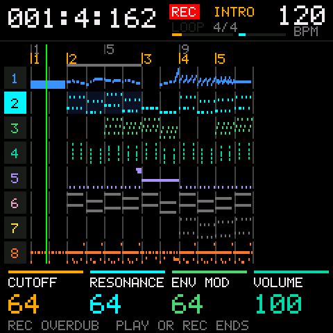 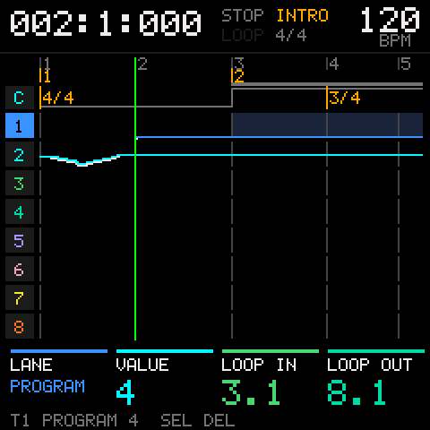

To see what's recorded, SHIFT+LFO opens the automation view, and K1 picks the lane. To delete it:

| To delete | Do this |
|---|---|
| One lane in the selection | In the automation view, K1 to the lane, then SHIFT+SEL |
| One change | In the automation view, SHIFT+PRESETS to it (it jumps change to change), then SEL |
| Every lane on some tracks | The ERASE job (SHIFT+EDIT, K1 to ERASE) with K3, EVENTS, on CCS. It starts on ALL, which takes the notes too |
| The last take | Undo, HOME+SAVE. Its notes go with it |

SHIFT+E4 in the song view deletes the automation in the selection along with the notes.

## Good to know

**The song view and the grid play different things.** The song view plays only the song, and the grid plays
only launched clips. Moving between them switches each track over at the next launch point, and the
transport keeps running. In the grid the transport keeps running past the song's end, until PLAY.

**Blocks are links, pasted notes are copies.** A block in the song plays a clip from the grid, live. A block
can only play its own track's clips, so one pasted onto another track lands as that clip's notes instead,
and later edits to the clip don't reach it.

**Nothing slides.** Paste, duplicate and delete work over what's there, and the bars after them stay where
they are. Only inserting bars (SHIFT+D4) moves later music.

**The selection is always there.** It's the loop region's bars on the picked tracks, whether the loop is on
or off. It starts as the current track and follows SELECT until tracks are picked by hand.

**PLAY comes back.** PLAY starts from the start point and a stop returns to it, so PLAY, listen, PLAY hears the
same passage again. PRESETS, the markers and SHIFT+PLAY move the start point.

**One gesture is one undo.** A knob turned over many clicks, a whole take or a job each undo in one step, up
to 64 of them.

**Quantize afterwards.** A take keeps its raw timing, so turning K2 in the song view after a take quantizes it
again to the new grid.

**How long the song is.** A new song is 8 bars at 120 BPM in 4/4. It grows when a take or a paste runs past
the end. In the song settings (GLO), page 1's K4 sets the length directly. Shortening hides bars past the end without
deleting them.

**What's saved where.** A song saves its notes, clips, automation, markers, settings, the sounds on its tracks
and the name of its kit. Step entry's zoom, the grid's recording length and the song list's last action are kept while
the FM-1 is on. The start point isn't kept.

**Saving waits for a stop.** Nothing is written to flash while the song plays. After playback stops, a
recovery copy of an unsaved song is written, and the song list offers it after a restart.

**YES and NO are OCT+ and OCT-** on the song list, in the edit jobs and while naming. Elsewhere they move the
keyboard's octave.

## Quick reference

| To | Press |
|---|---|
| Play or stop | PLAY |
| Record | REC |
| Record settings | Hold REC |
| Step entry, in or out | SHIFT+REC |
| REPLACE or OVERDUB | SHIFT+SEL |
| Undo, redo | HOME+SAVE, SHIFT+HOME+SAVE |
| Save | SAVE, SAVE |
| Song view, grid | SEQ |
| Song settings | GLO |
| Mixer | Hold GLO |
| Effects | FX |
| Move the playhead | PRESETS |
| Zoom | ALGO |
| Loop on or off | ENV |
| Metronome | SHIFT+ENV |
| Add or remove a marker | LFO |
| Marker to marker | SHIFT+PRESETS |
| Pick tracks | Hold SEL, tap F3 to F4 (G4 for all) |
| Copy, cut, paste | SHIFT+F3, SHIFT+G3, SHIFT+A3 |
| Duplicate, delete, insert bars | SHIFT+C4, SHIFT+E4, SHIFT+D4 |
| Automation view | SHIFT+LFO |
| Edit jobs | SHIFT+EDIT |
| Delete a lane's automation in the selection | SHIFT+SEL in the automation view |
| Change a track's instrument | Hold HOME, turn PRESETS |
| Stop everything, go to the stock overview | HOME+PLAY |
