# QSEQ user guide

New to QSEQ? [Getting started](getting-started.md) explains the screen and walks through a first song.
This guide is the full reference. Its screenshots come from the preview's checks, which regenerate them on
every run, so they match the build.

This covers the song mode as it is built, in the full device build (`FM1_SONG_DEVICE_FULL=1`) and in the
browser preview, which has all of it. The default device build is the hardware test build: it has only a
diagnostics page, described at the end. Song playback timing has been measured on the FM-1 with that build.
The full build has run on the FM-1 since 0.1.0.

Names are the ones printed on the panel and shown on the screen.

Every button light is on, all the time, on every page, so the printed labels can be read. The lights don't
show which page or mode is active. The one exception is PLAY: while the song plays it blinks with the beat,
lit for the first half of each beat and dark for the second, through a take's count-in too, whether or not
the metronome is on. The key lights work as described below.

## The panel

| Control | Name in this guide | In song mode |
|---|---|---|
| Buttons | FX | SHIFT on every song page while held. A tap opens the effects page from the song view, the grid, the automation view and the settings |
| | SEL | Held, it selects: tracks in the song view and the edit jobs, notes in step entry. A tap opens a clip in the grid and deletes a change in the automation view. SHIFT+SEL switches REC between REPLACE and OVERDUB |
| | ENV, LFO | Loop and markers in the song view, delete and back-delete in step entry. SHIFT+ENV is the metronome, SHIFT+LFO the automation view |
| | EDIT | Sound editing, as in the stock firmware. SHIFT+EDIT opens the edit jobs |
| | GLO | Song settings. A hold opens the stock mixer, which stays when GLO is let go. A GLO tap there goes back |
| | HOME, SAVE | Leave to the stock overview, and the song list |
| | ARP | The arpeggiator, as on the stock pages: a tap turns it on or off, a hold opens its settings. In step entry, the glitch layer's pages |
| | SEQ | The song view, and from there the clip grid |
| | PLAY, REC | Transport and recording. PLAY starts from the start point and a stop comes back to it. A tap of REC records, SHIFT+REC is step entry (and leaves it), and a hold opens the record settings |
| | OCT- / OCT+ | Move the keys an octave, two at most each way. On the song list, the edit jobs and while naming they are NO and YES |
| Encoders | SELECT | The track |
| | ALGO (ALGORITHM) | Turns pages on pages that have them. Zooms the song view, the clip editor, the automation view and the roll |
| | K1 to K4 | The four knobs above the screen. Their labels sit at the bottom of the screen |
| | PRESETS | Moves the playhead in the song view, the clip editor and the automation view, and the pointer in step entry. Beside ALGO, so one hand has where you are and how wide you see |
| Keys | F3 to G5 | 27 keys: 16 white, 11 black |

The white keys from left to right are F3 G3 A3 B3 C4 D4 E4 F4 G4 A4 B4 C5 D5 E5 F5 G5. The first eight, F3 to
F4, often stand for tracks 1 to 8.

## Getting around

The FM-1 starts on the stock overview. SEQ goes to the song view.

**YES and NO.** On the song list, the edit jobs and while naming a grid row, OCT+ is YES and OCT- is NO, as
on the QY70's +1/YES and -1/NO keys. A question shows as a box over the page with `OCT+ YES   OCT- NO` under
it. It stays until YES, NO, or a change that cancels it (another song, action or setting, or leaving the
page). It never times out. With nothing open, NO goes back to the song view. In the song view and step entry
OCT- and OCT+ still move the keyboard's octave.

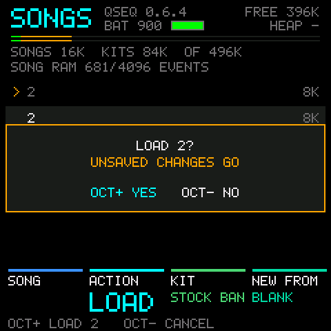

| Page | How to get there | How to leave |
|---|---|---|
| Song view | SEQ from any stock page, or from the grid | SEQ to the grid, HOME to the stock overview |
| Clip grid | SEQ in the song view | SEQ back to the song view |
| A clip in the editor | SEL on a grid cell | SEQ closes it and goes back to the grid |
| Record settings | Hold REC in the song view, the automation view, the grid or step entry | HOME goes back. REC or PLAY goes back and records there |
| Step entry | SHIFT+REC in the song view, or on a row of the grid | SHIFT+REC or SEQ, back to the view it was opened from. Playing goes on |
| Song settings | Tap GLO on a song page | Tap GLO again |
| Device settings | SHIFT+GLO on a song page (or HOME+GLO anywhere) | HOME, or SEQ |
| Automation view | SHIFT+LFO in the song view | SHIFT+LFO again |
| Edit jobs | SHIFT+EDIT in the song view | HOME, EDIT or NO (OCT-) |
| Song list | SAVE on any page | HOME or NO (OCT-) |
| Sound editing | EDIT | EDIT again returns to the song page |
| Effects | Tap FX on the song view, the grid, the automation view or the settings | FX goes back, SEQ goes to the song view |
| Arpeggiator settings | Hold ARP on those pages | HOME goes back |

These work on every song page:

| Buttons | Action |
|---|---|
| SAVE | The song list, which opens as SAVE comes up, from the song view, the automation view, the grid, the edit jobs and the stock pages. There SAVE saves the song, so a save is SAVE, SAVE. Not while a question or a naming is open, or while recording |
| SHIFT+SAVE | The same |
| HOME+SAVE | Undo, up to 64 steps (fewer when steps are large). HOME or SAVE can go down first, and the song list doesn't open |
| SHIFT+HOME+SAVE | Redo |
| HOME+PLAY | Stop everything and go to the stock overview |
| PLAY on a stock page | Play the song from the start point, as in the song view, or the grid's launched clips on a page opened from the grid or with a clip open. PLAY again stops |
| SELECT | The track |
| OCT- / OCT+ | The keyboard's octave. NO and YES on the song list, the edit jobs and while naming |

Each poll's edits are one undo step, so a knob turned over many moves undoes as one. A recording take is one
step, and so is a take into a cell of the grid, with the clip it made. Flash writes happen only while stopped. A recovery copy of an unsaved song is written after playback
stops, at most every 15 seconds, and the song list offers it after a restart.

## Song view

Tracks are rows, bars run across. The loop region is shaded and is also the selection. Only the song plays
here, on every track. Coming from the grid, every track goes back to the song at the next launch point, or at
once when stopped or with the launch quantize off. [Getting started](getting-started.md#the-screen) labels
everything on this screen.

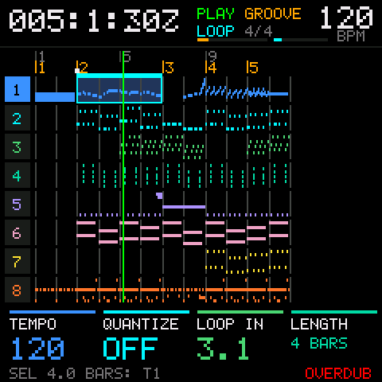 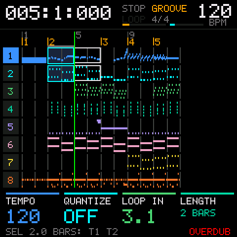

| Control | Action |
|---|---|
| PLAY | Play from the start point, and stop back there (below). During a take, end the recording and play on |
| SHIFT+PLAY | Back to the loop start, or the song start when the loop is off. It becomes the start point |
| REC | A tap, stopped: a take in the song's mode (see Recording). Playing with a clip open: record into the clip (below). During a take, end the recording and play on |
| SHIFT+REC | Step entry at the playhead, stopped |
| Hold REC | The record settings |
| PRESETS | Move the playhead one snap step, and the start point with it. While playing, a jump waits for the next bar line |
| SHIFT+PRESETS | Marker to marker |
| ALGO | Zoom: ALL, 16, 8, 4 or 2 bars across. The snap follows: a bar, half a bar, a beat or an 8th. ALL shows the whole song, as large as it fits (16 bars for a shorter song), snapping a bar, or more bars on a song past 64. The bottom line shows both for a moment, `ZOOM 8 BARS  SNAP 1/2 BAR`. During a take, the roll's zoom (see Recording) |
| K1 | Tempo: the one the header shows, the starting tempo or the tempo change the playhead is past. Whole BPM, 20 to 300, heard at once while playing |
| SHIFT+K1 | Tempo by half BPM |
| K2 | Input quantize, as in the record settings: off, or 1/64 to 1/1, each with a triplet. After a take it requantizes the take (Recording) |
| K3 | LOOP IN: move the whole loop a snap step, its length kept. It stops at the song's end |
| SHIFT+K3 | Select the marker section around the playhead. Turning on adds the next sections |
| K4 | LENGTH: the loop's length from its start, in snap steps, shown in bars, beats or 8ths |
| ENV | Loop on or off |
| SHIFT+ENV | Metronome: off, on, or only while recording |
| LFO | Stopped: add a marker at the playhead, or remove the one already there. Playing: add one at the nearest snap step |
| SHIFT+SEL | REC's mode: REPLACE or OVERDUB (from PUNCH or LOOP, OVERDUB) |
| SHIFT+LFO | The automation view |
| SHIFT+EDIT | The edit jobs |
| Hold SEL, tap F3 to F4 | Add or remove tracks 1 to 8 from the selection |
| Hold SEL, tap G4 | All tracks, or back to just the current one |

New markers are named M1, M2 and so on, taking the first free number, 16 at most. To remove one, go to it
with SHIFT+PRESETS, which lands on it exactly, and press LFO. Removing only happens while stopped. HOME+SAVE
brings a removed marker back.

**Tempo.** K1 changes the tempo in effect at the playhead, the number in the header. Before the song's first
tempo change that is the starting tempo, and past one it is that change. Settings page 1 sets the starting
tempo and time signature. Tempo is set in whole BPM, with SHIFT for half. A tempo with hundredths, from a
MIDI file say, keeps them until a knob turns it, and the first step lands on the knob's grid: from 119.88,
K1 goes to 120 or 119, and SHIFT+K1 to 120 or 119.5. The header shows a half as 79.5, and two decimals only
for real hundredths. The stock instrument's tempo follows (Song settings), and turning K1, however far, is
one undo step.

**The start point.** PLAY starts from the start point, and every stop comes back to it: PLAY again, a take
ending with a stop, or the song playing out at its end. So PLAY, listen, PLAY plays the same passage again.
Whatever puts the playhead somewhere on purpose sets it: PRESETS, SHIFT+PRESETS marker to marker, SHIFT+F4 to
G5 to a marker, SHIFT+PLAY, SHIFT+PRESETS change to change in the automation view, and step entry (its PLAY
sets the pointer's bar, and leaving puts the playhead at the pointer). While playing, the jump PRESETS asked
for, waiting for the bar line, is the start point. A loaded or new song starts at the top. The start point
isn't saved with the song. While the playhead is elsewhere, a small white mark on the ruler shows it. The
grid, the automation view and a clip in the editor use it too, the clip with one of its own that starts at
its top.

The selection starts as the current track and follows SELECT until tracks are picked by hand.

SHIFT plus a key:

| Keys | Action |
|---|---|
| F3 | Copy the selection |
| G3 | Cut |
| A3, B3 | Paste at the playhead, over what's there. Nothing after it moves |
| C4 | Duplicate: paste right after the selection, over what's there, and move the selection onto the copy |
| D4 | Insert empty bars the length of the selection |
| E4 | Delete the selection: the notes, clip blocks and automation that start in it, on the selected tracks only. Nothing moves, and the other tracks are left alone |
| D#4 | Clear the clipboard, and the paste outline with it |
| F#3 | Mangle: scramble the 16ths in the selection |
| G#3 | Mangle: reverse the note order |
| A#3 | Mangle: shuffle notes between the selected tracks |
| F4 to G5 (white) | Jump to markers 1 to 9 |

One copied track pastes onto the current track. Several paste back onto their own tracks. The clipboard
survives loading another song. SHIFT+D#4 clears it, in the song view or the grid. A clip copied in the grid
pastes as a clip block instead (see Clips in the song).

While the clipboard holds something, a white outline from the playhead shows where a paste would land and how
long it is, so PRESETS can line it up before SHIFT+A3.

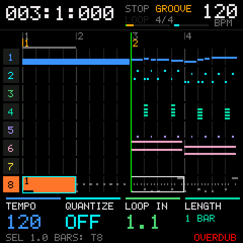

## Recording

REC works the same way in the song view, the automation view, the grid and step entry:

- **A tap** (REC let go within 600 ms) records live, in the song's mode. It acts as REC comes up. In the song
  view and the automation view, stopped, the take starts at once with its count-in. Playing, it says to stop
  first, unless a clip is open in the editor (A clip in the editor). The grid records into the cell at the
  cursor (Recording into a cell). Step entry records from the start of the pointer's bar (Step entry).
- **SHIFT+REC** is step entry, stopped: at the playhead in the song view, in the clip with one open, and on a
  row of the grid in the cell's clip. In step entry SHIFT+REC leaves it.
- **A hold** of 600 ms opens the record settings. HOME goes back to the page it was opened from.
- A REC that ends something acts as it goes down: it ends a take, calls off a count-in, or ends or disarms a
  performance.

The song's mode is one of the four live modes, and a new song's is OVERDUB. SHIFT+SEL switches it between
REPLACE and OVERDUB, and from PUNCH or LOOP to OVERDUB, in the song view, the clip editor and the grid, with a
notice. Those show the mode in red at the right end of the bottom line while nothing else needs it. The mode is
saved with the song. A song saved before 0.4.0 with STEP, the old default, loads in OVERDUB.

A take in REPLACE or OVERDUB with the loop off doesn't stop at the song's end. It runs on, and the song grows a
bar at a time to hold what's recorded, so a part can be played on past the last bar. Undo takes the bars back
with the take. PUNCH and LOOP stay inside the loop, as before. Settings page 1's K4 sets the song's length
directly (Song settings).

The record settings:

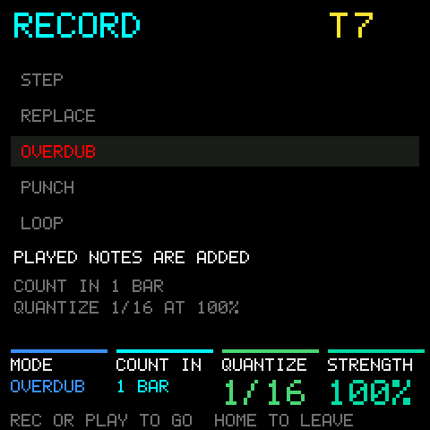 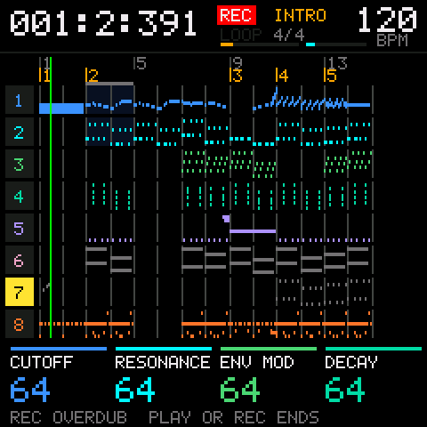

| Control | Setting |
|---|---|
| SELECT | The track to record |
| K1 | REPLACE, OVERDUB, PUNCH (inside the loop only), LOOP (each pass overdubs) or STEP |
| K2 | Count-in: off, 1 or 2 bars |
| K3 | Input quantize: off, or 1/64 to 1/1, each with a triplet |
| K4 | Quantize strength, 0 to 100% |
| REC or PLAY | Go back to the page and do what a tap of REC does there, or with STEP what SHIFT+REC does (from step entry, just go back) |
| HOME | Go back to the page |

A live mode picked with K1 becomes the song's mode, the one shown in red in the list. STEP never does: picking
it and leaving keeps the last live mode. In the grid PUNCH and LOOP record as OVERDUB.

**Early keys land on the beat.** A key played just before a take's first beat goes on that beat: in the
count-in, or before a grid cell's launch, or as a playing clip comes round to start its take. In a LOOP take,
and in every take into a grid cell, a key just before the loop's end goes on its first beat, where the next
pass starts. The note ends where you let go, or if you let go before the beat, it keeps the length you held
it. "Just before" is 100 ms, kept under a 16th note at fast
tempos so a 16th pickup stays where you played it: at 120 BPM that comes to about 94 ms. With input quantize
on it is half the grid when that is wider, so anything that would quantize onto the loop's end goes to its
start instead. Earlier than that, a key in the count-in isn't recorded, and one in a loop ends where the
loop goes round. In the clip editor the QUANTIZE job sends a note that lands on the clip's end round to its
start the same way.

During a take:

| Control | Action |
|---|---|
| PLAY or REC | End the take. Playing goes on, and PLAY again stops. In the count-in, before anything is recorded, they call the take off and stop |
| K1 to K4 | Record their parameters on the take track. Which parameter each knob drives is on settings page 3 |
| ALGO | Zoom the roll |
| PRESETS | Nothing: the playhead stays with the take |

**A turned knob latches until the take ends.** From its first turn, a knob writes its parameter all the way to
the end of the take, whether it's turning or not: when it stops, its value holds, and whatever the lane had
under the playhead is replaced. When the take ends, the lane goes back to its older values from there on. In a
LOOP take, or a take into a clip or a grid cell, each pass replaces the one before, so the last pass is what
stays, and a take ended partway through a pass keeps the pass before for the rest of the loop. Knobs that
aren't turned leave their lanes alone. Before 0.6.2 a knob let go 300 ms after its last turn and the older
values came back, which mixed passes together.

**A take shows the roll.** A take into one track, from the song view, the clip editor, a grid cell or step
entry, shows that track (the clip, for a clip) as step entry's roll while it is armed or running: the count-in,
the playhead, which the roll follows, and the recording knobs in the footer, with no pointer. ALGO zooms it as
in step entry, and the zoom stays. The header says REC and the bottom line what the take is doing. A note
shows as its key comes up, when the take writes it. When the take ends the view it started from comes back,
still playing if it plays on. A performance stays on the grid, so you can see what you launch, and a take in
the automation view stays there.

Recorded notes are stored already quantized. The take keeps its raw timing, so turning K3 or K4 in the
record settings afterwards requantizes the last take, and so does K2 in the song view or the clip editor,
which says so on the bottom line when notes move. A take into a grid cell can't be requantized once the grid
is back, since its clip closes with it. Undo takes the whole take back. If the song's memory
fills during a take, the take ends there and says so.

## Step entry

The screen shows the track as a small piano roll: the notes at their real lengths, the pointer in amber, and
under the roll a row of dashes, one per cell, the pointer's lit. The header has the pointer's position, the
time signature and, at the right, the span ALGO has zoomed to.

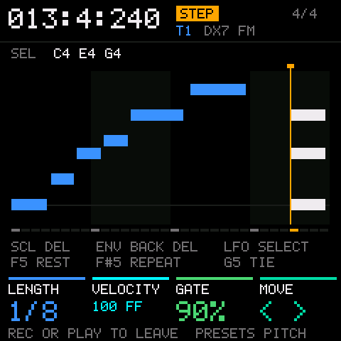 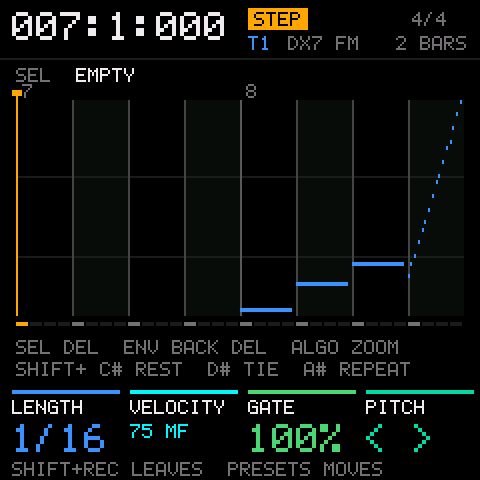

| Control | Action |
|---|---|
| Keys F3 to G5 | Enter a note at the pointer. Hold several to build a chord, which goes in when every key is up |
| SHIFT + F G A B C D E | Length: 1/1, 1/2, 1/4, 1/8, 1/16, 1/32, 1/64 |
| SHIFT+F# | Triplet on or off |
| SHIFT+G# | Dot, double dot, off |
| SHIFT+C# | Rest: move on one step |
| SHIFT+D# | Tie: lengthen the last entry by the current length |
| SHIFT+A# | Repeat the last entry |
| K1 | Length: 1/1 at the left, and each step right halves it, down to 1/64, the same order as SHIFT+F to E |
| K2 | Velocity, 1 to 127, named by the nearest of PPP to FFFF. Past the top: random R1 to R4 |
| K3 | Gate: 50, 90, 99 or 100% |
| K4 | Pitch: move the selected notes by scale step, by octave with SHIFT. On drum tracks, from pad to pad. The footer says PITCH, OCTAVE or PAD |
| PRESETS | Move the pointer one step. SHIFT+PRESETS jumps note to note |
| Hold SEL, turn PRESETS | Sweep a selection (below) |
| ENV | Delete the selected notes |
| LFO | Back-delete: move back one step and delete there |
| Hold SEL, tap keys | Pick which notes at the pointer K1 to K3 and delete act on. In a sweep, pick pitches in it |
| ALGO | Zoom the roll: 4 bars, 2 bars, 1 bar or half a bar |
| ARP | The glitch layer's pages: 1, 2, 3, then off (below) |
| PLAY | Play from the start of the pointer's bar, staying here. PLAY again stops back at that bar |
| REC | A tap: a take on the track (below). A hold: the record settings, where HOME or REC comes back here |
| SHIFT+REC or SEQ | Leave, back to the view step entry was opened from |
| SELECT | The track |

With SHIFT held a key works by its note name, in any octave, so SHIFT+F3, SHIFT+F4 and SHIFT+F5 all pick 1/1. It
enters no note.

When the pointer lands on notes they're selected and play, and K1 to K3 change them in place. On an empty spot
the knobs set the next entry.

**Zoom.** ALGO zooms the roll to 4 bars, 2 bars, 1 bar or half a bar across. It starts at 1 bar and keeps the
zoom while the FM-1 is on. The roll shows a span that starts on a bar line, the spans counted from the start of
the song or the clip, and at half a bar the half holding the pointer. The pitch range comes from the notes in
the span. Bar lines are the brightest, beat lines a step dimmer, and at 1 bar or closer faint lines mark the
16ths, and at half a bar the 32nds too. A kind of line shows only where its lines are 4 px apart or more, so at
4 bars a bar of many short beats, 16/16 say, keeps its bar lines and drops the beats. At 2 and 4 bars the bar
numbers are over the roll. The dashes follow the zoom: 8ths at 4 bars, 16ths at 2 bars, 32nds at 1 bar and half
a bar, or 64ths there when the notes or the pointer need them, never narrower than 2 px. Every note ends 1 px
short, so two in a row on one pitch read as two.

**Playing.** PLAY plays from the start of the pointer's bar and stays in step entry: the song, or in a clip
the clip with the grid's launched clips, as the clip editor plays it. A green playhead runs across the roll,
which turns its pages to follow it, and the header says PLAY. While it plays the keys only sound: nothing is
entered, SHIFT still sets the length, triplet and dots, and rest, tie and repeat wait for a stop. ENV, the
knobs and the pitch knob still edit. PLAY again stops, back at the pointer's bar, the start point (Song view),
with the pointer where it was.

**Recording here.** A tap of REC records a take on the track, as a tap does in the song view, in the song's
mode: from the start of the pointer's bar with the count-in, or playing in a clip, from its next pass. The
roll shows the take (Recording): no pointer, the recording knobs in the footer, ALGO still zooming. The take
stays in step entry when it ends.

**Leaving.** SHIFT+REC or SEQ goes back to the view step entry was opened from: the song view, the
automation view, the clip editor or the grid. Stopped, the playhead follows the pointer out and starts there
next. Playing goes on: in the song view the song plays on, and in the grid the clip stays launched. Leaving
ends a sweep.

**Sweeping a selection.** Hold SEL and turn PRESETS: the pointer moves as usual, and the selection becomes every
note that starts from where the sweep began to the pointer, both included, at every pitch. A lighter band
shows the range, the selected notes are white, and the SEL line counts them, for example `16 NOTES`. With SEL
still held, a key picks its pitch alone, and later keys toggle theirs in or out, across the whole range. On
a drum track that picks one pad, every hi-hat in two bars, say. Then:

| Control | On a sweep |
|---|---|
| ENV | Delete every selected note |
| K2 | Velocity, by the same amount for every note, so accents stay |
| K1, K3 | Length and gate: each note's length scales as the entry's does, 1/16 to 1/8 doubling them |
| Glitch layer K1 to K3 | That field on every note |
| K4 | Move every note, by scale step, octave or pad. A note whose new pitch is taken at its clock stays |

Each is one undo step. A change undo couldn't hold (about 630 notes on the device) is refused with a notice,
and nothing changes. The sweep ends when the pointer moves without SEL, a note goes in, or step entry is left.

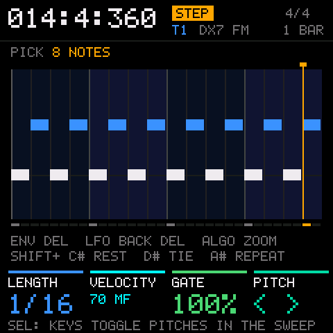 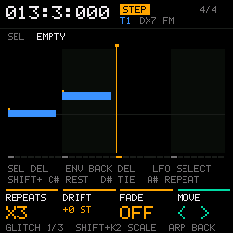

The glitch layer gives each new or selected note glitch attributes. ARP steps through its three pages and
back off, and ALGO still zooms, PRESETS moves the pointer and K4 the pitch:

| Page | K1 | K2 | K3 |
|---|---|---|---|
| 1 | Repeats (x2 to x8 inside the note) | Drift per repeat (SHIFT+K2: by scale step) | Fade of the last repeat |
| 2 | Chance | Octave jump chance | Octave range |
| 3 | Accent | Flam | Pad swap (drum tracks) |

## Song settings

Tap GLO on a song page. ALGO turns the five pages. They're saved with the song.

| Page | K1 | K2 | K3 | K4 |
|---|---|---|---|---|
| 1 | Starting tempo, whole BPM (SHIFT: half) | Time signature beats (SHIFT: the unit) | Swing, 0 to 50% (SHIFT: its grid, 8th or 16th) | The song's length, 1 to 999 bars. Longer adds empty bars at the end. Shorter hides what's past the end without deleting it, and brings the loop inside |
| 2 | Key | Scale | Metronome: OFF, ON, REC | Launch quantize (clips) |
| 3 | The parameter K1 records | ...K2 records | ...K3 records | ...K4 records |
| 4 | Humanize timing, up to 30 clocks | Humanize velocity, up to 30 | | |
| 5 | Chord mode on or off | Voicing | Strum | Direction |

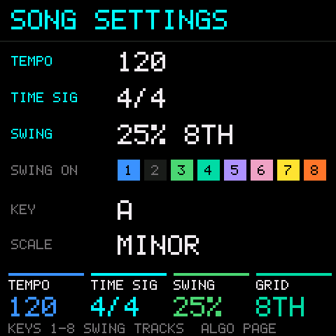 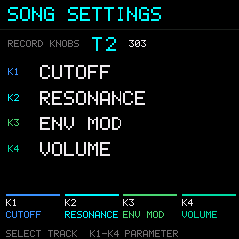

On pages 1 and 2 the keys F3 to F4 switch swing per track, and their lights show which tracks swing. Pages 3,
4 and 5 are for the track SELECT picks. Tempo and time signature here are the song's starting values. K1 in
the song view changes the tempo in effect at the playhead (Song view).

The stock instrument keeps a tempo of its own, in whole BPM from 30 to 300, for the arpeggiator, the synced
delay, the stock pages' tempo and MIDI clock out. It follows the song's tempo where the playhead is, rounded: as
playing crosses a tempo change, after a jump, and whenever the song's tempo changes. A tempo set on a stock page
(the effects page's delay, the clock settings) or by tap tempo goes into the song instead: the starting tempo,
or the tempo change the playhead is past. With MIDI clock coming in, neither changes.

Scales: chromatic (no snapping), major, minor, Dorian, Phrygian, Lydian, Mixolydian, Locrian, harmonic minor,
melodic minor, major pentatonic, minor pentatonic and blues. With a scale set, played keys outside it move up
to the next scale note on pitched tracks, the key lights show the scale, and the pitch knob in step entry
moves by scale step. Drum tracks ignore the scale.

The song's kit is chosen on the song list (K3).

## Device settings

SHIFT+GLO opens the stock Bluetooth and clock page. ALGO turns on to the stock pages that used to live on SEQ:
SYNC / LOOP, MIDI TRACK, MIDI ROUTING and TRACK ROLE.

## Automation view

SHIFT+LFO in the song view. The conductor row sits above track 1. Turning SELECT down past track 1 reaches it.

| Control | Action |
|---|---|
| SELECT | The row: a track, or the conductor |
| PRESETS | Move the playhead one snap step, as in the song view |
| SHIFT+PRESETS | Move to the next or previous change on the row |
| ALGO | Zoom, as in the song view, with or without SHIFT |
| K1 | The lane shown: one of the track engine's parameters, or programs. On the conductor: tempo or time signature |
| K2 | Stopped: set a change at the playhead. Tempo in whole BPM (SHIFT: half), the time signature from that bar, or a program change |
| K3, K4 | LOOP IN and LENGTH, as in the song view. SHIFT+K3 selects the marker section |
| SEL | Delete the change at the playhead |
| SHIFT+SEL | Clear the shown lanes in the selection |

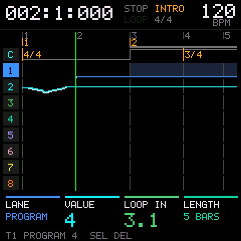

The footer shows the lane on K1 and its value at the playhead on K2, or a dash where the lane has no value
yet. Everything else works as in the song view, REC included, but SHIFT+SEL clears lanes here, and the bottom
line doesn't show REC's mode. A take here stays in this view instead of showing the roll, and controller
lanes are recorded with K1 to K4 during it, K1 and K2 recording rather than picking the lane or setting a
change. To clear every lane at once rather than the shown one, use the ERASE job with EVENTS on CCS (Edit
jobs). Tempo runs 20 to 300 BPM, set in whole BPM, with SHIFT for half (Song view). Time signatures run 1/4
to 8/4, 1/8 to 16/8 and 1/16 to 16/16.

## Glitch

Per-note glitch is in step entry: ARP there steps through the glitch layer's pages (see Step entry). Mangle is
SHIFT+F#3, G#3 and A#3 in the song view: scramble the 16ths, reverse the note order, or shuffle notes between
the selected tracks. Humanize per track is on settings page 4. Swing is on page 1.

The live stutter and the FX lane are gone since 0.3.0. A song saved with FX lane events still loads, without
them.

## Arpeggiator and effects

On the song view, the grid, the automation view and the settings, ARP and FX work as on the stock pages:

| Control | Action |
|---|---|
| Tap ARP | The arpeggiator on or off for the track |
| Hold ARP | Its settings page. HOME comes back to the song page |
| Tap FX | The effects page: the track's sends, the shared effects, and the delay, which PRESETS turns between. FX comes back, SEQ goes to the song view. On the delay page SEQ taps the tempo, as on the stock pages |
| Hold FX | SHIFT, as everywhere on the song pages |

A tap is a press and release within 600 ms with no other button, key or knob used meanwhile. In step entry,
the song list, the edit jobs and the record settings FX is only SHIFT, and ARP opens no settings.

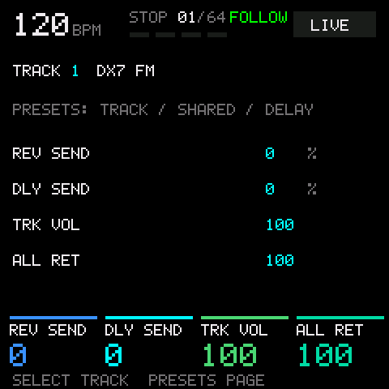 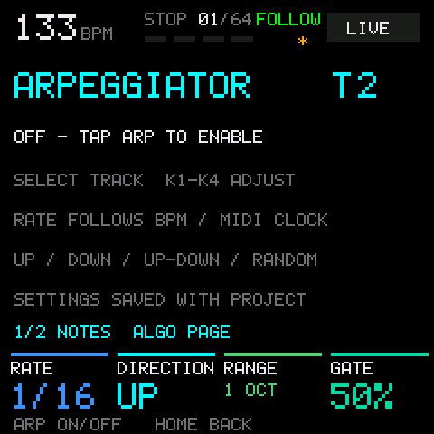

**The mixer.** Hold GLO on a song page. It stays open when GLO is let go, and a tap of GLO or HOME goes back.
F3 to F4 mute tracks 1 to 8 and G4 to G5 solo them. K1 to K4 set the levels of tracks 1 to 4, or of 5 to 8
when SELECT is on one of those.

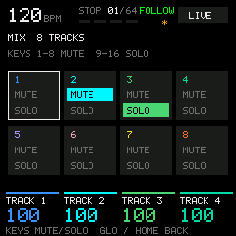

## Edit jobs

SHIFT+EDIT in the song view. K1 picks the job. K2 to K4 set its settings, ALGO turns to the next three, and
SHIFT moves a setting by ten. YES (OCT+) asks first, with how many events the job takes on
(`QUANTIZE 120 EVENTS?`), and says when it is too big to undo. YES again runs it as one undo step. NO cancels
the question, and so does changing the job, a setting, the track or the picked tracks. With no question open
NO goes back to the song view, as HOME and EDIT do. SAVE opens the song list. PLAY plays. Hold SEL and tap keys to
pick tracks, as in the song view. RANGE is the selection or the whole song.

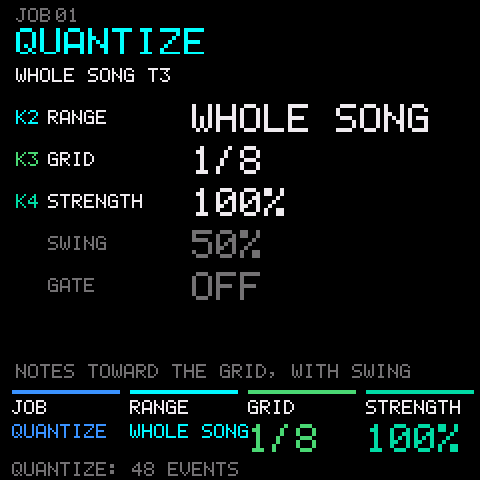 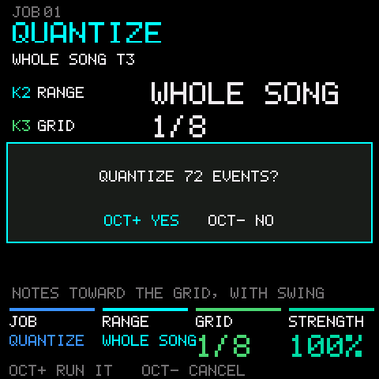

Jobs: QUANTIZE, VELOCITY, CRESCENDO, GATE TIME, TRANSPOSE, FIT TO SCALE, SHIFT CLOCK, CHORD SORT, STRUM,
PASTE N TIMES, ERASE, EXTRACT, RAMP, THIN OUT, TIME STRETCH, COPY TRACK, MERGE TRACKS, CLEAR TRACK, NORMALIZE
and EXPAND CLIPS. With a clip open, the jobs that reach other tracks or the song's time are refused.

ERASE's K3, EVENTS, picks what goes: NOTES, CCS (the automation lanes), PROGRAMS or ALL. It starts on ALL, so
for automation only, set it to CCS.

## Song list

SAVE on any page, as SAVE comes up. A memory gauge shows songs, kits and free space, and the header shows the
firmware's version, as the boot screen does, with the free flash at the right. Under the version are the
battery's reading from its sensor, for example `BAT 580`, smoothed and updated at most once a second, and a
bar. The bar is full at 622, a full battery read on a device with USB unplugged, and empty at 505, an
estimate. K2 picks an action and YES does it. The line at the bottom always says what YES will do and to
what, for example `OCT+ LOAD VERSE   OCT- BACK`.

Right of the battery, under the free flash, the full build shows the free heap in KB after `HEAP`: the RAM
left with the engines running, as the largest free block inside the heap, found by the diagnostics' memory
probe. It is measured once each time the list opens, only while nothing plays, and every block the probe gets
is freed at once. Opened while playing, it reads `HEAP -` until playing stops. A "+" means it reached the top
of the probe's search, so it's that much or more, and `HEAP ?` that malloc gave a block outside the heap, so
there's no reading. The browser preview has no heap and always shows `HEAP -`.

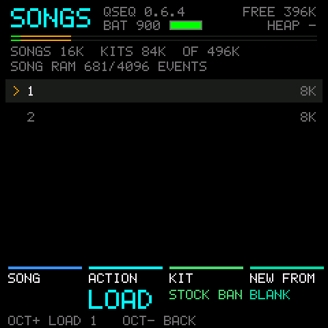 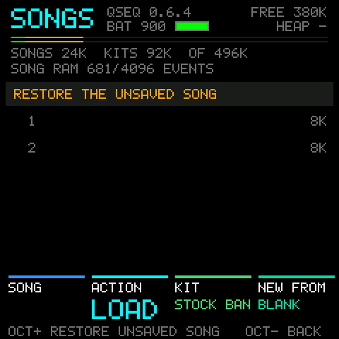

A song saves the sounds on its tracks with it: each track's instrument and settings, the arpeggiator, and
the name of its kit. Loading the song brings them back.

| Control | Action |
|---|---|
| K1 or SELECT | Pick a song |
| K2 | The action: LOAD, SAVE, SAVE AS (a new song), NEW, RENAME, DUPLICATE or DELETE. It starts on LOAD and keeps the last pick while the FM-1 is on |
| K3 | The kit. The pads switch at once and nothing is written |
| K4 | NEW FROM: what a new song starts from |
| YES (OCT+) | Do the action |
| NO (OCT-) | Cancel a question or a naming. With nothing open, back to the song view |
| SAVE | Save the song being worked on, so a save anywhere is SAVE, SAVE. Not while a question or a naming is open |
| HOME | Back to the song view |

What YES does:

| Action | YES |
|---|---|
| LOAD | Loads the picked song and opens it in the song view. With unsaved changes it asks first (`LOAD VERSE? UNSAVED CHANGES GO`) |
| SAVE | Saves the song being worked on |
| SAVE AS | Saves it as a new song. A song still named with a number gets the next free one |
| NEW | Starts a new song from K4's pick, not saved yet, named with the lowest number no saved song uses (1, 2, 3 and so on), so renaming it is quick. With unsaved changes it asks first |
| RENAME | Names the picked song: K1 or SELECT picks the letter, K2 changes it, YES keeps the name, NO leaves the old one |
| DUPLICATE | Copies the picked song |
| DELETE | Asks (`DELETE VERSE?`), then deletes |

A question goes when another song is picked or K2 or K4 turns. The note keys do nothing on the list. Nothing
is written while the song plays: stop first. On the recovery row (RESTORE THE UNSAVED SONG) LOAD restores
the copy, also into the song view, and DELETE removes it from flash, asking first, so a restart doesn't offer it again. RENAME and
DUPLICATE don't work there. SAVE, SAVE AS and NEW work as anywhere, since they act on the song being worked on.

In the full build the stock factory sound sets are left out, so a new song starts blank. The workbench can
build a song from a factory sound set and upload it.

## Clip grid

SEQ in the song view. Eight tracks across, 16 rows in two pages of 8, and a SONG row on top. A clip is one
track's loop, a beat to 16 bars long. Only launched clips play here: a track plays a clip or nothing, and the
song can't be heard. Coming from the song view, every track playing the song stops at the next launch point,
or at once when stopped or with the launch quantize off, and the transport runs on. In the grid the song goes
round at its end instead of stopping, so the transport keeps running until PLAY.

| Control | Action |
|---|---|
| SELECT | The track (column) |
| K1 | The row cursor, the SONG row first |
| K2 | REC LENGTH: 1, 2, 4, 8 or 16 bars, or FREE. It starts on 4 bars and keeps the last pick while the FM-1 is on |
| K3 | The length of the clip at the cursor: a bar a click, a beat with SHIFT, from a beat to 16 bars. Notes past the end are kept, hidden, and play again when it grows. It works while the clip plays. An empty cell has no length to set |
| K4 | Launch quantize: off, beat, bar, 2 bars or 4 bars |
| F3 to F4 | Launch that track's cell in the cursor row. An empty cell stops the track. On the SONG row they stop their track |
| G4 to G5 | Launch rows 1 to 8 of the page on every track (a scene). Tracks with nothing in the row stop |
| SEL | Open the clip at the cursor. An empty cell gets a new one-bar clip |
| SHIFT+SEL | REC's mode: REPLACE or OVERDUB (Recording) |
| ENV | Name the row: K1 picks the letter, K2 changes it, YES (OCT+) keeps the name, NO (OCT-) leaves the old one. SAVE does nothing while naming |
| SHIFT + F3, G3, A3 or B3, E4 | Copy, cut, paste, paste, delete the cell |
| SHIFT+D#4 | Clear the clipboard |
| PLAY | Play and stop. Launching a clip while stopped starts playback. Stopping leaves every track stopped and the playhead back at the start point (Song view). During a take, end the recording and play on |
| REC | A tap: record into the cell at the cursor (below), and on the SONG row record a performance (Clips in the song). REC again ends it |
| SHIFT+REC | Step entry in the cell's clip from its start, stopped. An empty cell first gets a clip of the REC length, 4 bars when it's FREE. On the SONG row it says step entry needs a row |
| Hold REC | The record settings. HOME comes back to the grid |

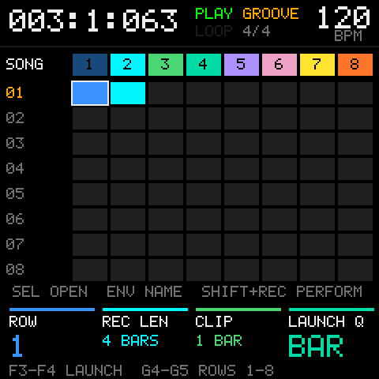 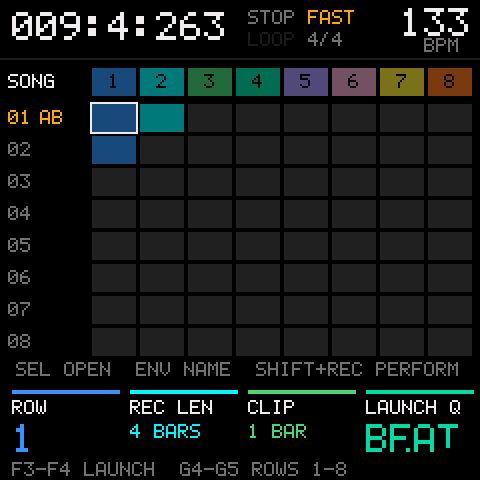

Launches wait for the launch quantize, counted on the song's bar lines. The loop's wrap and the song's end
count as launch points too. A clip starts from its beginning and keeps its phase through song loops and
jumps. The track keys light while their clip plays and blink while a launch waits.

Pasting copied song bars into a cell turns them into a clip. Several copied tracks paste across the row.

### Recording into a cell

A tap of REC records into the cell at the cursor, on the cursor's track. From the tap until the take ends the
screen shows the cell's clip on the roll (Recording): the count-in or the wait for the launch, then the
playhead and the notes as they go in, and the bottom line says what is happening. The grid comes back as the
take ends.

- **An empty cell** becomes a clip of the REC length. Playing, it launches on its track at the launch quantize
  (with the launch quantize off, at the next beat), and recording starts there. The track leaves the song or
  its other clip, as with any launch. Stopped, REC starts playing with the record settings' count-in, and
  recording starts after it. The other tracks play their launched clips meanwhile, so from a stop they're
  silent. With a length set, recording ends by itself at the end of the clip, and the clip
  plays on, launched. With FREE, REC ends it at the next bar line (it can run to 16 bars), and the clip is
  that many bars long.
- **A cell with a clip** follows the song's mode. In OVERDUB, PUNCH or LOOP it is overdubbed as loop
  recording, from its next pass (from its first if it launches for the take), until REC or PLAY. In REPLACE
  the clip is emptied as REC is tapped, keeping its length, and then recorded into the same way. The
  emptying is part of the take's undo step, so undo brings the old clip back, even when the take was called
  off.
- While a cell is armed or recording, the keys play its track (at the keyboard's octave, with chord mode when
  the track has it) and go into the take, instead of launching. OCT- and OCT+ move the octave. SELECT stays on
  the track, and the SHIFT keys, SEL and ENV wait. K1 to K4 record their lanes, as in the song view, and ALGO
  zooms the roll. The keys launch again when the take ends.
- PLAY or REC ends the take, and playing goes on. In the count-in, before anything is recorded, PLAY or REC
  calls it off, stops, and an empty cell stays empty.

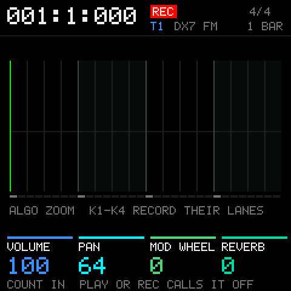 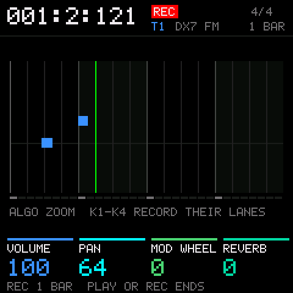

The record settings' input quantize applies, and the metronome when it is set to play while recording. The
take, and a new clip with it, is one undo step. SEQ waits until the take is over.

### A clip in the editor

SEL on a cell opens the clip in the song view's editor, looped to its own length. K4, labelled CLIP END,
sets that length. Step entry (SHIFT+REC), recording, automation, glitch and the jobs that stay inside the
track all work on the clip. SELECT stays on the clip's track, and the markers are hidden. The other knobs
work as in the song view: PRESETS moves the playhead, ALGO zooms, K1 is the tempo the header shows, which
here is the tempo where the song is, the one you hear, not at the clip's own place, K2 input quantize, requantizing a take made here while the clip is open, and K3 the loop start. SHIFT+PRESETS and
SHIFT+K3 do nothing, with no markers to go to. SEQ closes it and goes back to the grid. SHIFT+REC on a row of
the grid opens the cell's clip straight
into step entry, where PLAY plays the clip without leaving, and SHIFT+REC or SEQ goes back to the grid, the
clip staying launched if it plays, so you can enter and listen without leaving the grid.

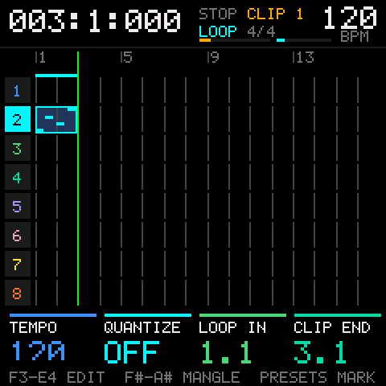

The open clip plays with the grid's other launched clips while it is open, not with the song, so a part can
be written against them. REC while playing records into the clip as loop recording from its next pass, and
the rest plays on. REC or PLAY ends the recording and playing goes on, and PLAY again stops. Recording from a
stop works as in the song view.

## Clips in the song

A block in a track's row plays a clip from the grid: "clip 3 from bar 9 to bar 17". Inside a block the clip
loops from the block's start and the track's own notes stay quiet. A stop block keeps the track silent. In
the song view a block shows in the track's color with the clip's row number in black, as the grid's cells
do, and the clip's notes on it. The track's own notes aren't drawn inside a block, since they don't play
there. A stop shows dark with an X. A block ends at its length or where the next one on its track starts.
Editing a clip changes it everywhere it's used.

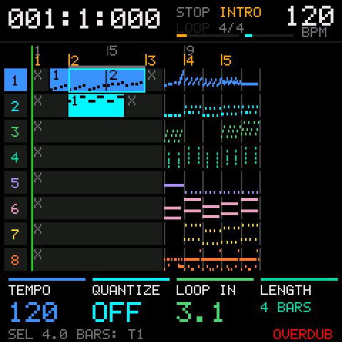 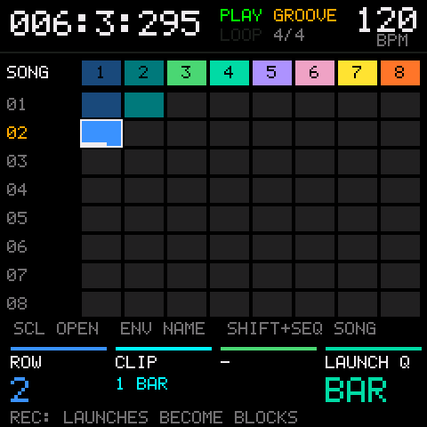

**Recording a performance.** In the grid, a tap of REC on the SONG row arms it. The take starts with the next
launch, or with PLAY. The song gets what was heard over the take. Each launch writes a block for its track
from the launch point to that track's next launch or stop. A track that was silent gets a stop block, and a
track playing a clip as the take starts gets a block of that clip from there. A block plays its clip from the
top, so a clip that was partway through a pass as the take started plays from its top there instead. Played
back, the song sounds like the performance. The song's loop is
ignored and the song grows to hold the take. REC, PLAY or stopping ends it, PLAY with playing going on, and
the whole take is one undo step. SEQ waits while a performance is armed or running.

**By hand.** Copy a cell in the grid (SHIFT+F3), go to the song view, and paste with SHIFT+A3 or SHIFT+B3. The
block lands at the playhead, the clip's length long, and becomes the selection. SHIFT+C4 (Duplicate) then
extends it. Copy, paste, delete and insert bars carry blocks as they carry notes. A block can only play a
clip of its own track, so one copied in the song view and pasted onto another track lands as its clip's
notes there, a copy rather than a link, as in Ableton. The clip's automation stays behind, since it was made
for the other sound, and so does whatever the block kept silent on its own track. A grid copy only pastes
as a block into the song it came from.

**Expand.** The EXPAND CLIPS job turns the blocks starting in its range into plain notes on their tracks, so
one spot can go its own way. It refuses when the song can't hold the result. MIDI export in the workbench
expands every block.

## Chord mode

Chord mode is a setting per instrument track on settings page 5. It works on the song pages. The stock pages
play single notes as before, and drum tracks ignore it.

With it on, the keyboard splits:

| Keys | Action |
|---|---|
| F3 to E4 | Roots. Each plays a whole chord of the picked type. OCT- and OCT+ move them |
| F4 to E5 | Pick the type, which stays picked. Picking one while a root is held changes the sounding chord |
| F5 | Play the last chord again |
| F#5 | The last chord an octave down |
| G5 | The last chord an octave up |

The type keys:

| Key | Type | Key | Type |
|---|---|---|---|
| F4 | In key | F#4 | Sus2 |
| G4 | Major | G#4 | Sus4 |
| A4 | Minor | A#4 | Dim |
| B4 | 7 | C#5 | Aug |
| C5 | m7 | D#5 | Add9 |
| D5 | Maj7 | | |
| E5 | 6 | | |

In key builds each root's chord from the song's scale: the root and the second and fourth scale notes above
it. In C major, D gives D minor and C# gives C# dim. With no scale set it plays major.

Settings on page 5:

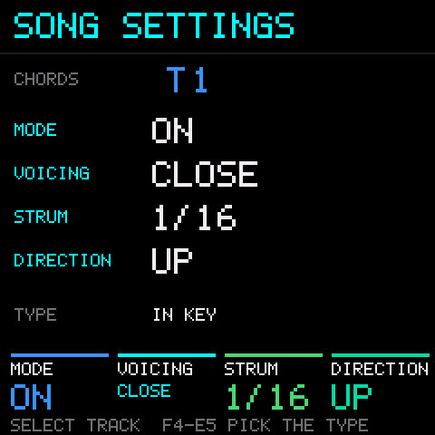

| Knob | Setting |
|---|---|
| K1 | On or off. A drum track shows DRUMS |
| K2 | Voicing. CLOSE is the shape on the root. SPREAD lifts its second note an octave. SMOOTH picks the inversion nearest the last chord |
| K3 | Strum, from the first note to the last: off, 1/64, 1/32, 1/16 or 1/8. It follows the tempo |
| K4 | Direction: up, down, alternating (up first) or random |

One chord sounds at a time, at velocity 100, while its key is held. A chord records as plain notes with its
strum. Input quantize moves a strummed chord as a whole, by its first note. In step entry a root enters its
chord at the pointer, strummed when strum is on, and F5, F#5 and G5 enter the last chord again, an octave down
or an octave up. Rest, tie and repeat stay on SHIFT there.

## The workbench

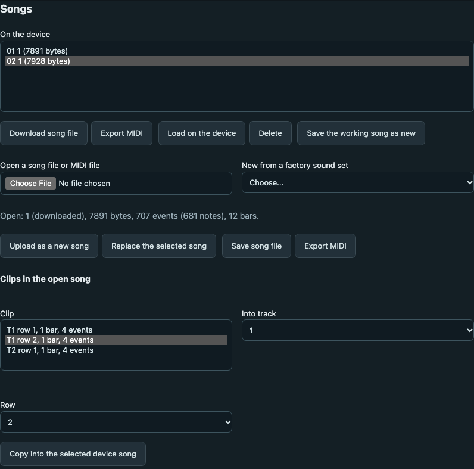

The workbench page (README.md, The workbench) has the Songs and kits section. Two of its buttons fill the
device from what FM1 Open's page carries:

| Button | What it does |
|---|---|
| Send the built-in kit | FM1 Open's 8 built-in sounds as a kit named BUILT-IN, unless they are on the device already |
| Send the factory DX7 voices | M-VAVE's 128 factory DX7 voices into the 4 banks of the DX7 library |

The full build leaves the factory voices out of the firmware, so until the DX7 library holds voices every DX7
preset there is blank. Sending them puts them in the library, in the user area, where they stay through
firmware updates. The workbench reads the 4 banks first, and when a bank holds voices of its own (saved
earlier, not the factory's) it asks before replacing it. It reads every bank back after writing and says if
one doesn't match. The new voices play at once, with no restart.

On the full build the page's project library tab connects, but it has no project slots: they show as empty, and
saving to one is refused. Songs and kits take their place.

## Diagnostics page

Only in the default device build, the hardware test build, and in the preview `./build.sh --test-preview`
makes. SEQ opens it from the stock pages, and SEQ again goes to the stock step page. The full build and the
regular preview don't have it.

| Control | Action |
|---|---|
| PLAY | Play and stop the built-in test song (12 bars) |
| K1 | The note delivery method, A or B, while stopped. It starts on B |
| SEL | Clear the numbers |
| ENV | Memory probe, with each engine on track 6 in turn (stopped) |
| LFO | Largest free memory block |
| HOME | Back to the stock overview |

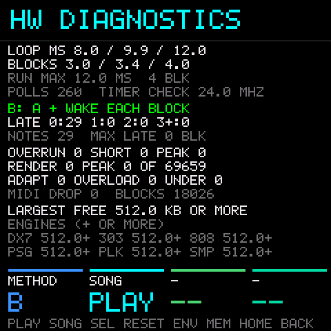

The page shows control loop timing, how late notes land for the method in use, audio health and memory. A
memory figure with "+" or "OR MORE" reached the top of the probe's search, so it's that much or more. The
hardware test plan in `docs/hardware-test-plan.md` says what to write down.
